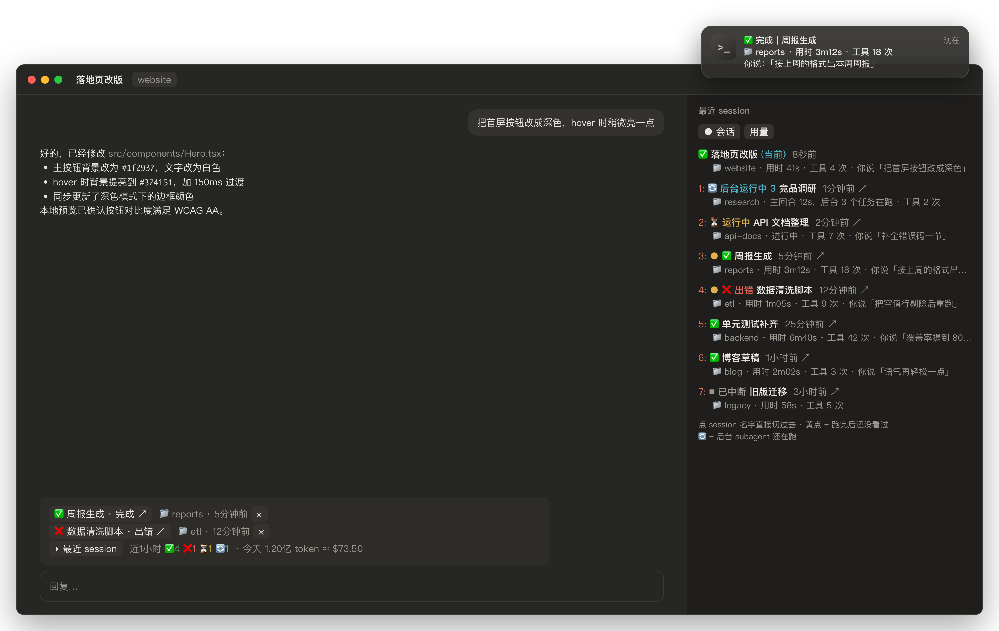
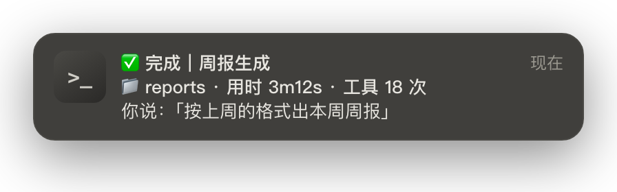
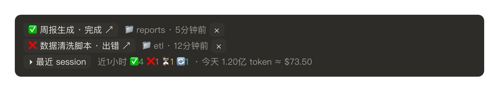
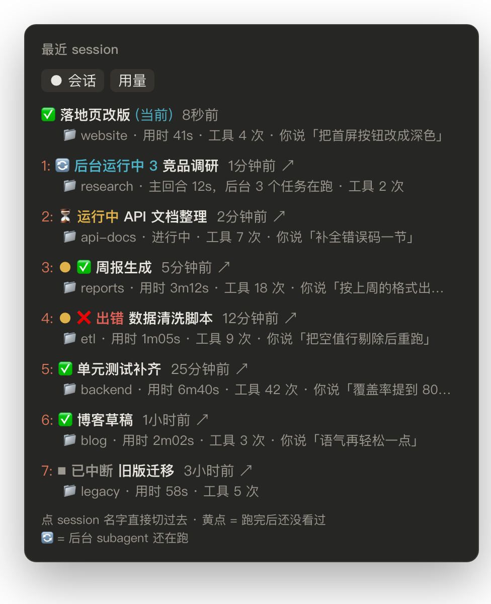
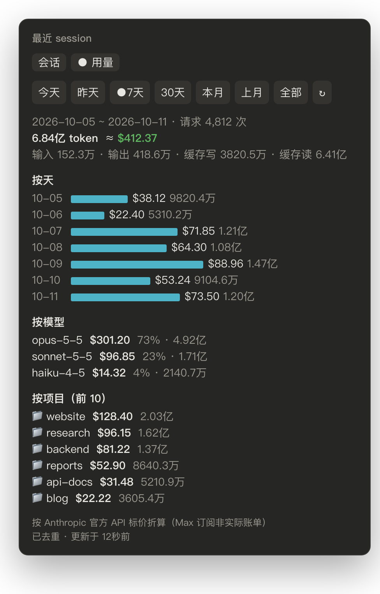

# session-radar

**Claude Code 桌面版（macOS）的 mod：同时开很多个 session 时，让你一眼看到哪个跑完了、点一下就切过去，顺便统计 token 用量。**



<sub>截图均为演示数据，按插件实际界面还原。</sub>

> English summary: a Claude Code **mod** for the **Claude desktop app on macOS**. It shows which of your many sessions just finished (macOS notification that jumps to the session on click, a custom sound, a band above the prompt, a "recent sessions" pane that also knows when background subagents are still running) and adds a token usage / cost page. UI text is Chinese. Install: `claude plugin install session-radar --marketplace Tina0529/claude-session-radar`, then restart the desktop app.

---

## 目录

- [能做什么](#能做什么)
- [使用前提](#使用前提)
- [安装（给人看的版本）](#安装给人看的版本)
- [安装（给 Claude Code 看的版本）](#安装给-claude-code-看的版本)
- [怎么用](#怎么用)
- [修改配置](#修改配置)
- [更新与卸载](#更新与卸载)
- [数据与隐私](#数据与隐私)
- [常见问题](#常见问题)
- [已知限制](#已知限制)
- [开发者说明](#开发者说明)

---

## 能做什么

### 1. 跑完提醒：系统通知 + 提示音

- 任何一个 session 的一轮回答结束，屏幕右上角弹出 macOS 通知。
- **点击通知，桌面 App 直接切到那个 session**（需要装 terminal-notifier，见安装步骤）。
- 通知内容一眼能认出是哪个 session：

  ```
  ✅ 完成｜我的项目名
  你说：「帮我把登录页的报错修一下…」
  📁 my-project · 用时 2m13s · 工具 18 次
  ```

  

- 同时播放提示音。完成和出错用不同的声音，都能换成你自己的音效。
- 很快就结束的回合（默认 20 秒以内）不打扰你，因为你多半正盯着看。出错和中断总会提醒。

### 2. 输入框上方的横条

每个 session 的输入框正上方多出一条：

```
✅ 设计评审 · 完成 ↗   📁 design · 2分钟前   ×
▸ 最近 session   近1小时 ✅5 ⏳2 🔄1   · 今天 1.2亿 token ≈ $86.40
```



- **别的 session 刚跑完、你还没去看**，会出现在这里。点 `↗` 跳过去，点 `×` 忽略。
- 最下面一行是近 1 小时的统计：✅ 完成、⏳ 运行中、🔄 后台运行中、❌ 出错，以及今天的 token 用量和折算金额。
- 点「▸ 最近 session」打开右侧看板，再点一次收起。

### 3. 右侧看板「最近 session」

**会话页**：列出最近的所有 session。

```
1: ● ✅ 设计评审  43秒前  ↗
   📁 design · 用时 41s · 工具 4 次 · 你说「把配色改成深色」
2: 🔄 后台运行中 3 竞品调研  1分钟前  ↗
   📁 research · 主回合 12s，后台 3 个任务在跑 · 工具 2 次
```



- **分类标签页**：`待处理`（一天内跑完还没看的、出错 / 中断的）· `运行中`（含后台运行中）· `★ 置顶` · `全部`，每个标签显示数量，选中的标签会被记住。
- **置顶**：点每行末尾的 ☆ 钉住常用的 session（再点取消）；置顶的 session 在「全部」里排最前，也不会因为过期被清掉。
- **点 session 名字那一行，直接切过去。**
- 看板有焦点时，**按数字 1–9** 直接跳到当前标签页里对应的 session。
- **黄点 ●**：一天内跑完、你还没回去看过（超过一天自动消失）。
- 「你说」只显示你自己打的话，后台任务通知、子 agent 消息、App 重启续跑之类的系统消息会被过滤掉。
- **🔄 后台运行中 N**：主回合已经答完，但后台还有 N 个 subagent 在跑。这时不算完成，不响也不弹通知。等后台全部跑完、session 整理出结果，才提示「完成」。
- 看板开着还是收起，在所有 session 之间同步。切换 session 时保持你上次的选择。

**用量页**：token 用量与按 API 标价折算的金额。



- 区间：今天、昨天、7 天、30 天、本月、上月、全部，也可以自定义。
- 内容：总计（输入、输出、缓存写、缓存读）、按天柱状图、按模型、按项目前 10。
- 数据来自本机 Claude Code 的日志，按请求去重后计价（见[数据与隐私](#数据与隐私)）。

### 4. 两个斜杠命令

| 命令 | 作用 |
|---|---|
| `/recent` | 打开或收起「最近 session」看板 |
| `/tokens` | 打开看板的用量页 |
| `/tokens 2026-09-01 2026-09-30` | 看指定日期区间的用量 |

如果 `/tokens` 和你已有的命令重名，插件会改用备用名 `/radar-usage`。

---

## 使用前提

| 项目 | 要求 | 怎么确认 |
|---|---|---|
| 系统 | **macOS**（用到 AppleScript 通知、afplay 播放声音、`~/Library` 目录） | — |
| App | **Claude 桌面版**，在它的 **Code 标签页**里用 Claude Code | — |
| Claude Code | **2.1.287 或更新**（这个版本开始支持 mods） | 终端运行 `claude --version` |
| Python | macOS 自带的 `/usr/bin/python3`（用量统计用） | 终端运行 `/usr/bin/python3 --version`；如果弹出「安装命令行开发者工具」，点安装即可 |
| terminal-notifier | **可选**。装了才能「点通知跳到 session」 | `command -v terminal-notifier` |

没有装 terminal-notifier 也能用。区别是点通知会打开 macOS 的「脚本编辑器」，而不是跳到 session。

---

## 安装（给人看的版本）

**第 1 步：在终端安装插件。**桌面 App 的 Code 标签页里不能运行 `/plugin install`，要在终端里装：

```bash
claude plugin install session-radar --marketplace Tina0529/claude-session-radar
```

如果提示找不到 `claude` 命令，先按 Claude Code 官方文档安装命令行版本，或者用桌面 App 自带的引擎（见下一节第 2 步）。

**第 2 步（可选，推荐）：装 terminal-notifier，让通知可以点击跳转。**

```bash
brew install terminal-notifier
```

装完运行一次下面这条，触发系统的通知授权：

```bash
terminal-notifier -title "session-radar" -message "测试通知"
```

如果没有弹出通知：打开「系统设置 → 通知」，找到 **terminal-notifier**，打开「允许通知」，提醒样式选「横幅」或「提醒」。

**第 3 步：完全退出并重新打开桌面 App。**菜单栏选 **Claude → Quit Claude**，然后重新打开。只关窗口不算退出。

**第 4 步：确认装好了。**打开任意一个 session，输入框上方应该出现「▸ 最近 session」那一条。让它跑一个超过 20 秒的任务，结束时应该会响、会弹通知。

---

## 安装（给 Claude Code 看的版本）

> 这一节写给 AI 助手。你可以把这个仓库的链接发给自己的 Claude Code，说「按 README 帮我装好 session-radar」。

**Claude Code，请按顺序执行下面的步骤。每一步都检查结果，失败时停下来告诉用户原因。**

1. **确认环境。**运行 `sw_vers -productName`，必须是 `macOS`；不是的话告诉用户这个插件只支持 macOS，然后停止。

2. **找到可用的 `claude` 命令。**
   - 先试 `command -v claude`。
   - 找不到的话，用桌面 App 自带的引擎：
     ```bash
     CL=$(ls -dt "$HOME/Library/Application Support/Claude/claude-code/"*/*/claude.app/Contents/MacOS/claude 2>/dev/null | head -1); echo "$CL"
     ```
     后续步骤里的 `claude` 都换成 `"$CL"`。
   - 运行 `claude --version`，版本必须 ≥ 2.1.287。低于这个版本时，请用户先更新桌面 App 或 Claude Code。

3. **安装插件**（user 作用域，所有项目、所有 session 都生效）：
   ```bash
   claude plugin install session-radar --marketplace Tina0529/claude-session-radar
   ```
   - 想在安装时就设置配置，可以加 `--config`，例如 `--config doneSound=Hero --config notifyMinSeconds=30`（配置项见[修改配置](#修改配置)）。
   - 如果报 marketplace 已存在，改用 `claude plugin install session-radar@session-radar`。

4. **确认安装成功**：
   ```bash
   claude plugin list 2>/dev/null | grep -A2 session-radar
   claude plugin configure session-radar@session-radar
   ```
   第二条会列出所有配置项和当前值。

5. **检查 Python**：运行 `/usr/bin/python3 --version`。失败的话告诉用户：用量页需要它，可以运行 `xcode-select --install` 安装命令行开发者工具。其他功能不受影响。

6. **terminal-notifier（可选）**：运行 `command -v terminal-notifier || ls /opt/homebrew/bin/terminal-notifier /usr/local/bin/terminal-notifier 2>/dev/null`。
   - 已经装了：跳到第 7 步。
   - 没装：**先问用户**要不要装（它用来让通知可以点击跳转）。用户同意后运行 `brew install terminal-notifier`，再运行 `terminal-notifier -title "session-radar" -message "测试通知"`。
   - 如果输出 `Notifications are not allowed for this application`，请用户自己去「系统设置 → 通知 → terminal-notifier」打开「允许通知」。这是系统权限，不要替用户修改系统设置。

7. **请用户重启桌面 App**：菜单栏选 **Claude → Quit Claude**，再重新打开。插件只在 App 重启后才加载到所有 session。不要试图用命令杀 App 进程，让用户自己操作。

8. **告诉用户怎么验证**：重启后，输入框上方会出现「▸ 最近 session」横条；输入 `/recent` 可以打开看板，输入 `/tokens` 可以打开用量页。

---

## 怎么用

装好就会自动工作，不需要额外操作。下面是几个常用的动作：

| 想做的事 | 怎么做 |
|---|---|
| 看所有 session 的状态 | 点横条上的「▸ 最近 session」，或输入 `/recent` |
| 跳到某个 session | 点系统通知；或点横条上的 `↗`；或在看板里点 session 名字；或在看板里按 1–9 |
| 忽略某条完成提示 | 点横条上那条提示右边的 `×` |
| 看今天花了多少 token | 看横条最右边；或输入 `/tokens` |
| 看某段时间的用量 | `/tokens 2026-09-01 2026-09-30`，或在用量页点区间按钮 |
| 立刻刷新用量 | 用量页点 `↻`（平时每 60 秒自动刷新一次） |

### 状态图标

| 图标 | 含义 |
|---|---|
| ⏳ 运行中 | 正在回答 |
| 🔄 后台运行中 N | 主回合答完了，还有 N 个后台 subagent 在跑 |
| ✅ | 完成 |
| ⏹ 已中断 | 你按了停止 |
| ❌ 出错 | API 报错等原因中止 |
| ● （黄点） | 跑完后你还没回去看过 |

### session 名字从哪来

- 优先用桌面 App 侧栏里的标题，也就是你改过的名字。
- 侧栏标题是 App 自动起的通用标题（比如长对话压缩后的「Continuing previous conversation」）时，改用项目文件夹名。
- 想让通知更好认，给 session 改个名就行：在侧栏里右键 session 重命名。

---

## 修改配置

### 可以改的配置项

| 配置项 | 默认值 | 作用 |
|---|---|---|
| `doneSound` | `Glass` | 完成时的提示音 |
| `errorSound` | `Basso` | 出错或中断时的提示音 |
| `sound` | `true` | 是否播放提示音 |
| `notify` | `true` | 是否弹 macOS 系统通知 |
| `notifyMinSeconds` | `20` | 短于这个秒数就结束的回合，不响也不弹通知（出错除外） |
| `speak` | `false` | 是否额外用 macOS 语音读出「<session 名> 完成」 |
| `keepDays` | `7` | 看板保留几天内的 session |

### 查看当前配置

```bash
claude plugin configure session-radar@session-radar
```

### 修改配置

用一段 JSON 传入要改的项，没写的项保持原样。**值统一写成字符串**：

```bash
echo '{"doneSound":"Hero","notifyMinSeconds":"30"}' | claude plugin configure session-radar@session-radar --values-stdin
```

改完后**重启桌面 App**（Claude → Quit Claude），所有 session 都会用上新配置。

配置保存在 `~/.claude/settings.json` 的 `pluginConfigs["session-radar@session-radar"].options` 里。没设置过的项使用默认值，不会出现在这里。

也可以在终端的 `claude` 里输入 `/plugin configure session-radar@session-radar`，在配置页里逐项修改。

### 换提示音

`doneSound` 和 `errorSound` 支持三种写法：

1. **系统自带音效的名字**：`Basso`、`Blow`、`Bottle`、`Frog`、`Funk`、`Glass`、`Hero`、`Morse`、`Ping`、`Pop`、`Purr`、`Sosumi`、`Submarine`、`Tink`。
   - 试听：`afplay /System/Library/Sounds/Hero.aiff`
2. **你自己的音效文件名**：把文件放进 `~/Library/Sounds/`，配置里只写文件名、不写扩展名。支持 `.aiff`、`.wav`、`.mp3`、`.m4a`、`.caf`。
   ```bash
   mkdir -p ~/Library/Sounds && cp ~/Downloads/done.mp3 ~/Library/Sounds/
   echo '{"doneSound":"done"}' | claude plugin configure session-radar@session-radar --values-stdin
   ```
3. **绝对路径**：例如 `/Users/me/sounds/done.wav`。

找不到指定的音效时，会退回播放 `Glass`。

> 用游戏、影视里的音效没问题，但那是你本机的私人文件，请不要把它们提交到公开仓库里。

### 只要看板，不要通知和声音

```bash
echo '{"notify":"false","sound":"false"}' | claude plugin configure session-radar@session-radar --values-stdin
```

---

## 更新与卸载

**更新到最新版：**

```bash
claude plugin marketplace update session-radar
claude plugin update session-radar@session-radar
```

然后重启桌面 App。

**卸载：**

```bash
claude plugin uninstall session-radar@session-radar
claude plugin marketplace remove session-radar
```

然后重启桌面 App。想连统计缓存一起删掉，再运行：

```bash
rm -rf ~/.claude/session-radar-data
```

---

## 数据与隐私

**所有数据都在你本机，插件不联网，不上传任何东西。**

插件**读取**：

| 位置 | 用途 |
|---|---|
| `~/.claude/projects/**/*.jsonl` | Claude Code 自己记录的对话日志，用来统计 token |
| `~/Library/Application Support/Claude/claude-code-sessions/` | 桌面 App 的 session 列表，用来查侧栏标题和跳转用的 ID |
| `/Applications/Claude.app` 里的图标 | 通知右侧显示的 Claude 图标 |

插件**写入**：

| 位置 | 内容 |
|---|---|
| `~/.claude/session-radar-data/usage.db` | 用量统计缓存（SQLite），只存 token 数、模型、时间、项目路径，不存对话内容 |
| `~/.claude/session-radar-data/claude.png` | 通知用的图标 |
| `~/.claude/plugins/store/session-radar*.json` | 看板的 session 记录、开关状态、最近 50 条诊断日志 |

### 关于金额

- 金额是按 **Anthropic 官方 API 标价**折算的，价目写在 `bin/usage.py` 的 `PRICES` 里（2026-09-25 的价格）。
- 如果你用的是 Pro / Max 订阅，这个数字**不是你的实际账单**，只表示「这些用量如果按 API 计费大约值多少钱」。
- 统计规则：
  - 同一个请求会因为会话恢复、分叉被复制到多个日志文件里，插件按请求 ID 去重，只算一次。
  - 缓存写入分 5 分钟、1 小时两档分别计价。
  - 快速模式按 2 倍计价。
- 遇到价目表里没有的模型，用量页底部会列出「未计价模型」，它们的金额按 0 计。

---

## 常见问题

**装好了但什么都没出现**

- 确认重启的是整个 App（Claude → Quit Claude），只关窗口不算。
- 终端运行 `claude plugin list`，确认 session-radar 是启用状态。
- 确认 Claude Code 版本 ≥ 2.1.287。

**点通知打开的是「脚本编辑器」**

- 说明没装 terminal-notifier，或者它没有通知权限，插件退回了 AppleScript 通知，而 AppleScript 通知没法指定点击后的去向。
- 按[安装](#安装给人看的版本)第 2 步装好并授权。
- 通知中心里旧的通知是按旧方式发的，点了还是会打开脚本编辑器，清掉即可。

**没有声音**

- 检查配置的音效名字：`claude plugin configure session-radar@session-radar`。
- 试听：`afplay /System/Library/Sounds/Glass.aiff`。听不到的话，检查 Mac 的音量和输出设备。
- 回合太短不会响：默认 20 秒以内结束的不响，可以调小 `notifyMinSeconds`。

**用量页一直显示「统计中」**

- 运行 `/usr/bin/python3 --version` 确认 Python 可用。
- 第一次统计要扫描全部历史日志，日志多的话需要十几秒到一分钟，之后是增量扫描，很快。

**有些 session 不在看板里**

- 只记录有窗口的 session。`claude -p` 这类没有窗口的定时任务会被有意过滤掉。
- 插件装好之前就打开、之后一直没重启过的 session，要在 App 重启后才会被记录。

**想看插件的诊断日志**

```bash
python3 -c "import json,glob;[print(x) for f in glob.glob('$HOME/.claude/plugins/store/session-radar*.json') for x in json.load(open(f)).get('log',[])[-10:]]"
```

每条记录里的 `notifyRc` 含义：`0` 表示 terminal-notifier 发送成功，`100` 以上表示退回了 AppleScript 通知，`-1` 表示这一轮不需要通知。

---

## 已知限制

- **只支持 macOS 的 Claude 桌面版。**在纯终端里也能加载，但通知跳转、侧栏标题这些依赖桌面 App 的功能不可用。
- **后台 shell 命令不算「后台运行中」**：只能数到 subagent。用 `run_in_background` 跑的长命令（渲染、下载等）结束前，session 仍会显示为完成。
- **App 内的小提示框不能点击跳转**：Claude Code 只允许点击关闭它。要跳转，请用系统通知、横条或看板。
- **界面文字是中文。**
- **价目表是写死的**：Anthropic 调价或出新模型后，需要更新 `bin/usage.py` 里的 `PRICES`。

---

## 开发者说明

```
.claude-plugin/
  plugin.json        插件清单，userConfig 定义所有配置项
  marketplace.json   让这个仓库本身成为一个 marketplace
hooks/
  hooks.json         指向 register.tsx
  register.tsx       mod 本体：事件钩子、横条、看板、通知、声音
bin/
  usage.py           token 用量统计（增量扫描 + 去重 + 计价，SQLite 缓存）
docs/
  images/            README 截图（演示数据）
  make-screenshots.py  重新生成这些截图
```

- **本地调试**：`claude --plugin-dir /path/to/claude-session-radar`，或在 Claude Code 里加载 `plugin-authoring` skill 后用热加载。
- **校验**：`claude plugin validate .`
- **单独跑用量统计**：
  ```bash
  /usr/bin/python3 bin/usage.py summary --range today --range 7d --scan
  ```
- mod 的 API 参考：在 Claude Code 里让它加载 `plugin-authoring` skill，会生成当前版本的类型定义文件。

欢迎提 Issue 和 PR。

## License

[MIT](LICENSE)
